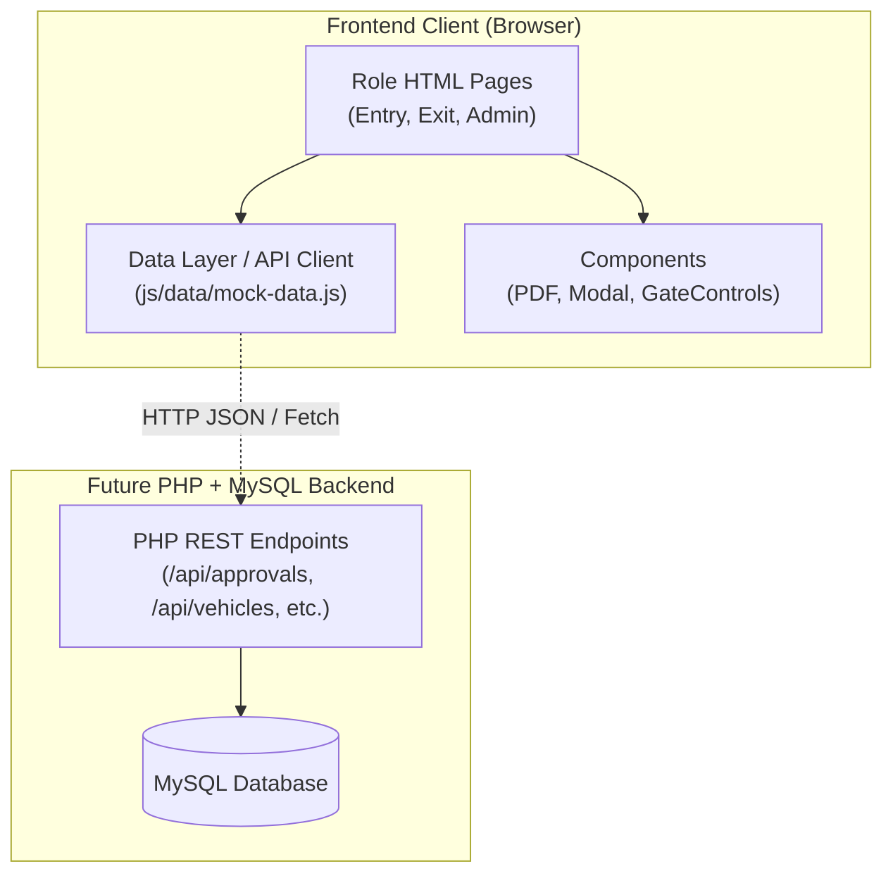

# HIPDC Gate & Logistics Management — Frontend Architecture & Backend Integration Guide

## 1. System Architecture Overview

The HIPDC Gate Management Frontend is designed with a **clean separation of roles**, **stateless HTML pages**, and an **event-driven Data Abstraction Layer** ready to plug into a PHP backend and MySQL relational database.



---

## 2. MySQL Relational Database Schema

When deploying the MySQL database for this system, create the following core tables:

```sql
-- 1. Users & Security Personnel Table
CREATE TABLE users (
    id INT AUTO_INCREMENT PRIMARY KEY,
    name VARCHAR(120) NOT NULL,
    username VARCHAR(60) NOT NULL UNIQUE,
    password_hash VARCHAR(255) NOT NULL,
    role ENUM('Officer', 'Admin') NOT NULL DEFAULT 'Officer',
    gate ENUM('Entry', 'Exit', 'All') NOT NULL DEFAULT 'Entry',
    shift ENUM('Day', 'Night') NOT NULL DEFAULT 'Day',
    status ENUM('Active', 'Suspended') NOT NULL DEFAULT 'Active',
    created_at TIMESTAMP DEFAULT CURRENT_TIMESTAMP
);

-- 2. Registered Park Vehicles Table
CREATE TABLE vehicles (
    id INT AUTO_INCREMENT PRIMARY KEY,
    company VARCHAR(150) NOT NULL,
    plate VARCHAR(40) NOT NULL UNIQUE,
    driver VARCHAR(120) NOT NULL,
    phone VARCHAR(30) NOT NULL,
    model VARCHAR(100) NOT NULL,
    license_expiry VARCHAR(30) NOT NULL,
    status ENUM('Active', 'Expiring', 'Blocked') NOT NULL DEFAULT 'Active',
    created_at TIMESTAMP DEFAULT CURRENT_TIMESTAMP
);

-- 3. Vehicle Schedules & Access Windows Table
CREATE TABLE schedules (
    id INT AUTO_INCREMENT PRIMARY KEY,
    company VARCHAR(150) NOT NULL,
    plate VARCHAR(40) NOT NULL,
    driver VARCHAR(120) NOT NULL,
    phone VARCHAR(30),
    model VARCHAR(100),
    window_time VARCHAR(60) NOT NULL,
    purpose ENUM('Delivery', 'Pickup', 'Maintenance') NOT NULL DEFAULT 'Delivery',
    status ENUM('Expected', 'Arrived', 'Inside', 'Completed') NOT NULL DEFAULT 'Expected',
    cargo_summary TEXT,
    created_at TIMESTAMP DEFAULT CURRENT_TIMESTAMP
);

-- 4. Gate Approvals Workflow Table
CREATE TABLE approvals (
    id INT AUTO_INCREMENT PRIMARY KEY,
    title VARCHAR(200) NOT NULL,
    gate ENUM('Entry', 'Exit') NOT NULL,
    plate VARCHAR(40) NOT NULL,
    company VARCHAR(150) NOT NULL,
    driver VARCHAR(120) NOT NULL,
    officer VARCHAR(120) NOT NULL,
    time_submitted VARCHAR(30) NOT NULL,
    status ENUM('Pending', 'Approved', 'Denied') NOT NULL DEFAULT 'Pending',
    officer_note TEXT,
    admin_reason TEXT,
    destination VARCHAR(150),
    waybill VARCHAR(100),
    items_json JSON,
    reviewed_at TIMESTAMP NULL,
    created_at TIMESTAMP DEFAULT CURRENT_TIMESTAMP
);

-- 5. Gate Access & Departure Audit Logs Table
CREATE TABLE gate_logs (
    id INT AUTO_INCREMENT PRIMARY KEY,
    gate ENUM('entry', 'exit') NOT NULL,
    plate VARCHAR(40) NOT NULL,
    driver VARCHAR(120),
    company VARCHAR(150),
    event_type VARCHAR(80) NOT NULL,
    admin_approval VARCHAR(80) DEFAULT '—',
    details TEXT,
    items_json JSON,
    created_at TIMESTAMP DEFAULT CURRENT_TIMESTAMP
);

-- 6. Visitor Registrations & QR Passes Table
CREATE TABLE visitors (
    id INT AUTO_INCREMENT PRIMARY KEY,
    name VARCHAR(120) NOT NULL,
    fayda_id VARCHAR(60),
    phone VARCHAR(30),
    company VARCHAR(150) NOT NULL,
    plate VARCHAR(40) DEFAULT '—',
    visit_date VARCHAR(30) NOT NULL,
    purpose VARCHAR(150) NOT NULL,
    status ENUM('Active', 'Entry used', 'Completed', 'Expired') NOT NULL DEFAULT 'Active',
    created_at TIMESTAMP DEFAULT CURRENT_TIMESTAMP
);
```

---

## 3. PHP REST API Endpoint Specifications

The frontend forms and asynchronous handlers in `mock-data.js` map directly to standard PHP scripts:

| Endpoint | Method | Payload / Parameters | Purpose |
| :--- | :--- | :--- | :--- |
| `/api/auth/login.php` | `POST` | `username`, `password`, `role` | Verifies officer/admin credentials and starts session |
| `/api/vehicles/index.php` | `GET` | `?query=...` | Returns JSON list of registered vehicles |
| `/api/vehicles/create.php` | `POST` | `company`, `plate`, `driver`, `model`, etc. | Registers a new vehicle into MySQL |
| `/api/schedules/index.php` | `GET` | `?query=...` | Returns scheduled vehicle arrivals |
| `/api/schedules/create.php` | `POST` | `company`, `plate`, `window`, `purpose` | Adds an expected vehicle appointment |
| `/api/approvals/index.php` | `GET` | `?status=Pending` | Retrieves requests awaiting Admin clearance |
| `/api/approvals/create.php`| `POST` | `gate`, `plate`, `note`, `items[]` | Gate officer creates clearance request |
| `/api/approvals/update.php`| `POST` | `id`, `status` (`Approved`/`Denied`), `reason` | Admin resolves request |
| `/api/logs/index.php` | `GET` | `?gate=entry` or `?gate=exit` | Retrieves historical gate pass records |
| `/api/logs/exit_create.php`| `POST` | Form fields from `fill-form.html` | Saves exit declaration & cargo manifest |

---

## 4. Admin Approval Synchronization Workflow

1. **Trigger**: Entry Gate officer encounters an unscheduled vehicle, OR Exit Gate officer fills the Goods Declaration Form.
2. **Submission**: Officer submits the request. Status is marked `Pending`.
3. **Barrier Interlock**: The gate opening button is programmatically disabled in the officer's browser.
4. **Admin Notification**: In `pages/admin/dashboard.html` and `approvals.html`, the dynamic pending badge increments in real time.
5. **Decision**: Admin reviews cargo, driver, and note. Admin clicks **Approve** or **Deny** (specifying reason).
6. **Live Reactive State**:
   * If **Approved**: The officer's status badge turns green (`✔ Approved by Admin`), and the barrier unlock action is enabled.
   * If **Denied**: The officer's status badge turns red (`✖ Denied by Admin`) with the admin's explanation displayed.
